# 🚚 Akıllı Lojistik Sistemi (Smart Logistics System)
> **Nesneye Yönelik Programlama (OOP) Dönem Projesi**  
> **Konu:** Araç kapasitesine göre paket dağıtımı ve teslimat rotalarının optimizasyonu  
> **Teslim Tarihi:** 29.10.2026  

---

## 📋 İçindekiler
1. [Proje Hakkında ve Amaç](#-proje-hakkında-ve-amaç)
2. [Nesneye Yönelik Programlama (OOP) Prensipleri](#-nesneye-yönelik-programlama-oop-prensipleri)
3. [SOLID Prensipleri Uyumluluğu](#-solid-prensipleri-uyumluluğu)
4. [Kullanılan Tasarım Kalıpları (Design Patterns)](#-kullanılan-tasarım-kalıpları-design-patterns)
5. [Kullanılan Algoritmalar](#-kullanılan-algoritmalar)
6. [UML Sınıf Diyagramı](#-uml-sınıf-diyagramı)
7. [Birim Testleri (Unit Tests)](#-birim-testleri-unit-tests)
8. [Kalıcı Veri Saklama (Persistence)](#-kalıcı-veri-saklama-persistence)
9. [Projeyi Çalıştırma ve Test Etme](#-projeyi-çalıştırma-ve-test-etme)
10. [10 Dakikalık Sunum Videosu Senaryosu (Video Script)](#-10-dakikalık-sunum-videosu-senaryosu-video-script)

---

## 🎯 Proje Hakkında ve Amaç
**Akıllı Lojistik Sistemi**, modern kargo ve tedarik zinciri operasyonlarında karşılaşılan iki kritik problemi nesneye yönelik programlama teknikleri ve optimizasyon algoritmaları ile çözmektedir:
1. **Kapasite Kısıtlı Paket Dağıtımı:** Dağıtılmayı bekleyen paketlerin ağırlık, hacim ve aciliyet durumlarına göre filodaki araçların (Kamyon, Panelvan, Motosiklet) kapasitelerine en verimli şekilde paylaştırılması.
2. **Rota Optimizasyonu:** Dağıtım merkezleri ve teslimat adresleri arasındaki ağırlıklı yol ağı üzerinde en kısa mesafeli ve en hızlı teslimat rotasının hesaplanması.

Uygulama konsol üzerinden etkileşimli bir CLI menüsü ile çalışmakta, verileri kalıcı JSON dosyasında saklamakta ve canlı durum bildirimlerini Observer deseni ile anlık olarak ekrana basmaktadır.

---

## 🧩 Nesneye Yönelik Programlama (OOP) Prensipleri

Proje, nesne yönelimli programlamanın 4 temel direğini eksiksiz olarak uygular:

### 1. Kalıtım (Inheritance)
- **`Vehicle` Soyut Sınıfı:** Tüm taşıtların ortak özelliklerini (plaka, kapasite, mevcut yük, konum vb.) taşır.  
  - `Truck` (Ağır Yük Kamyonu) $\rightarrow$ `Vehicle`'dan türer.
  - `Van` (Dağıtım Panelvanı) $\rightarrow$ `Vehicle`'dan türer.
  - `Motorcycle` (Kurye Motosikleti) $\rightarrow$ `Vehicle`'dan türer.
- **`Package` Soyut Sınıfı:** Tüm kargoların ortak özelliklerini (takip no, ağırlık, hacim, hedef vb.) barındırır.  
  - `StandardPackage` (Standart Kargo) $\rightarrow$ `Package`'dan türer.
  - `ExpressPackage` (Acil Kargo) $\rightarrow$ `Package`'dan türer.
  - `FragilePackage` (Kırılabilir Sigortalı Kargo) $\rightarrow$ `Package`'dan türer.

### 2. Soyutlama (Abstraction)
- Temel sınıflar ve arayüzler (`IRouteOptimizer`, `IPackageDistributor`, `ILogisticsRepository`, `ITrackingObserver`, `ITrackingSubject`) sistemin genel sözleşmelerini tanımlar.
- İstemci kodlar somut sınıfların iç ayrıntılarına değil, soyut arayüzlere bağımlıdır.

### 3. Çok Biçimlilik (Polymorphism)
- **Dinamik Metot Ezme (`@Override`):**
  - `Vehicle.calculateOperationalCost(distanceKm)`: Kamyon (120 TL sabit + 18.5 TL/km), Panelvan (50 TL + 9.0 TL/km) ve Motosiklet (20 TL + 3.5 TL/km) kat edilen mesafeye göre kendi operasyon maliyetlerini polimorfik olarak hesaplar.
  - `Vehicle.getSpeedFactor()`: Kamyon (60 km/s), Panelvan (75 km/s) ve Motosiklet (85 km/s) farklı hız katsayıları sunarak seyahat süresini dinamik belirler.
  - `Package.calculateShippingFee()`: Standart, Ekspres (ek katsayılı) ve Kırılabilir (sigorta bedelli) kargolar kendi kargo ücretlerini farklı formüllerle hesaplar.

### 4. Kapsülleme (Encapsulation)
- Tüm sınıf alanları (`id`, `plateNumber`, `weightKg`, `volumeM3` vb.) `private` olarak tanımlanmıştır.
- Veri erişimleri kontrollü `getter` ve `setter` metotlarıyla sağlanır.
- Kurucu metotlar ve setter'lar **veri doğrulama (validation)** kuralları içerir; örneğin negatif ağırlık, sıfır veya negatif kapasite, boş plaka/ID girildiğinde sistem kontrollü olarak `IllegalArgumentException` fırlatır.
- `Vehicle` sınıfında paket yükleme/boşaltma işlemleri doğrudan listeye müdahale edilerek değil, `canLoad()` ve `loadPackage()` metotları üzerinden kapasite sınırları denetlenerek gerçekleştirilir.

---

## 🏛️ SOLID Prensipleri Uyumluluğu

| Prensip | Uygulama Yeri ve Açıklaması |
| :--- | :--- |
| **S - Single Responsibility Principle (SRP)** | Her sınıfın tek ve net bir görevi vardır. `DijkstraRouteOptimizer` yalnızca rota hesaplar; `GreedyKnapsackDistributor` sadece paketleri araçlara paylaştırır; `JsonLogisticsRepository` verilerin JSON olarak saklanıp okunmasından sorumludur; `ConsoleMenu` ise yalnızca konsol kullanıcı etkileşimini yürütür. |
| **O - Open/Closed Principle (OCP)** | Sistem geliştirmeye açık, değişikliğe kapalıdır. Yarın sisteme `DroneDeliveryVehicle` veya `ColdChainPackage` (Soğuk Zincir Kargosu) eklemek istediğimizde mevcut kodları değiştirmeden sadece `Vehicle` veya `Package` sınıflarını genişletmemiz yeterlidir. Yeni bir rota algoritması (ör. A* Algoritması) `IRouteOptimizer` arayüzü uygulanarak sıfır kod değişikliğiyle sisteme takılabilir. |
| **L - Liskov Substitution Principle (LSP)** | `Vehicle` referansı bekleyen her yerde `Truck`, `Van` veya `Motorcycle` alt sınıfları, üst sınıfın yerine hiçbir beklenmeyen davranış üretmeden kusursuzca çalışır. Benzer şekilde tüm `Package` türevleri temel sınıf davranışlarını bozmadan genişletir. |
| **I - Interface Segregation Principle (ISP)** | Tek bir devasa arayüz yerine amaca odaklı, ayrık arayüzler tasarlanmıştır: `IRouteOptimizer`, `IPackageDistributor`, `ILogisticsRepository`, `ITrackingObserver`, `ITrackingSubject`. |
| **D - Dependency Inversion Principle (DIP)** | Üst seviye iş mantığı katmanı (`LogisticsService`), doğrudan somut sınıflara değil soyut arayüzlere (`IRouteOptimizer`, `IPackageDistributor`, `ILogisticsRepository`) bağımlıdır. Böylece bağımlılıklar esnekçe enjekte edilebilir (Dependency Injection). |

---

## 🛠️ Kullanılan Tasarım Kalıpları (Design Patterns)

### 1. Strategy Pattern (Davranışsal Kalıp)
- **Arayüzler:** `IRouteOptimizer` ve `IPackageDistributor`.
- **Somut Stratejiler:** `DijkstraRouteOptimizer`, `GreedyKnapsackDistributor`.
- **Faydası:** Rota bulma ve paket dağıtım algoritmaları çalışma zamanında (runtime) birbirleriyle değiştirilebilir hale getirilmiştir.

### 2. Factory Method Pattern (Yaratımsal Kalıp)
- **Sınıflar:** `VehicleFactory` ve `PackageFactory`.
- **Faydası:** Karmaşık nesne oluşturma mantığını istemciden gizler; doğru parametrelerle `Truck`, `Van`, `Motorcycle` veya `StandardPackage`, `ExpressPackage`, `FragilePackage` nesnelerinin güvenli ve tek tip üretilmesini sağlar.

### 3. Observer Pattern (Davranışsal Kalıp)
- **Konu (Subject):** `DeliveryTrackingManager` (`ITrackingSubject` uygular).
- **Gözlemci (Observer):** `ConsoleNotificationObserver` (`ITrackingObserver` uygular).
- **Faydası:** Bir paketin durumu değiştiğinde (`BEKLEMEDE` $\rightarrow$ `ARACA_YUKLENDI` $\rightarrow$ `DAGITIMDA` $\rightarrow$ `TESLIM_EDILDI`), sisteme abone olan tüm gözlemcilere anında canlı bildirim fırlatılır.

### 4. Repository Pattern (Veri Erişim Kalıbı)
- **Arayüz:** `ILogisticsRepository`.
- **Somut Sınıf:** `JsonLogisticsRepository`.
- **Faydası:** Verilerin nerede ve nasıl saklandığını (JSON, Dosya, Veritabanı) iş mantığından tamamen soyutlar.

---

## ⚡ Kullanılan Algoritmalar

### 1. Dijkstra En Kısa Rota Algoritması (`DijkstraRouteOptimizer`)
- **Amaç:** Şehirdeki transfer merkezleri ve teslimat adresleri arasındaki ağırlıklı yol ağı (Weighted Graph) üzerinde başlangıçtan hedefe olan en kısa mesafeyi bulur.
- **Veri Yapısı:** Öncelik kuyruğu (Min-Heap / `PriorityQueue`) ve komşuluk listesi (`Map<String, Map<String, Double>>`).
- **Zaman Karmaşıklığı:** $O((V + E) \log V)$
- **Geri İzleme (Path Reconstruction):** `predecessors` haritası kullanılarak en kısa rotayı oluşturan tüm durakların listesi sırayla elde edilir.
- **Çoklu Durak (Multi-stop Delivery / TSP Heuristic):** Bir araca birden çok paket yüklendiğinde, araç başlangıç noktasından itibaren en yakın komşu (Nearest Neighbor) stratejisi ve Dijkstra ile tüm teslimat noktalarını optimum sırayla dolaşır.

### 2. Açgözlü Sırt Çantası (Greedy Knapsack) Dağıtım Algoritması (`GreedyKnapsackDistributor`)
- **Amaç:** Bekleyen paketleri araçların ağırlık ($kg$) ve hacim ($m^3$) sınırlarını aşmadan, paketlerin aciliyet durumlarına göre filoya en verimli şekilde paylaştırmak.
- **Öncelik Sıralaması:**
  1. Paket türü önceliği: `Ekspres (3)` > `Kırılabilir (2)` > `Standart (1)`
  2. Birim ağırlık/hacim yoğunluğu: $\frac{\text{Kargo Ücreti}}{\text{Ağırlık} + \text{Hacim} \times 20}$
- **Best-Fit Eşleştirme:** Küçük ve acil paketler öncelikle motosiklet veya panelvanlara, ağır kargolar kamyonlara yönlendirilir. Kapasitesi dolan araçlara yeni yükleme yapılmaz.

---

## 🗺️ UML Sınıf Diyagramı

```mermaid
classDiagram
    direction TB

    class DeliveryStatus {
        <<enumeration>>
        BEKLEMEDE
        ARACA_YUKLENDI
        DAGITIMDA
        TESLIM_EDILDI
        IPTAL
    }

    class Location {
        -String id
        -String name
        -String city
        -String district
        +getId() String
        +getName() String
    }

    class RouteGraph {
        -Map~String, Location~ locations
        -Map~String, Map~String, Double~~ adjacencyList
        +addLocation(Location loc)
        +addRoad(Location from, Location to, double distanceKm)
        +getNeighbors(String id) Map
    }

    class RouteResult {
        -List~Location~ path
        -double totalDistanceKm
        -double estimatedTimeMinutes
        -boolean found
        +isFound() boolean
    }

    class Package {
        <<abstract>>
        -String id
        -String trackingCode
        -String senderName
        -String recipientName
        -Location destination
        -double weightKg
        -double volumeM3
        -DeliveryStatus status
        -double baseCost
        +calculateShippingFee()* double
        +getHandlingInstructions()* String
        +getPriorityLevel()* int
        +getPackageType()* String
    }

    class StandardPackage {
        +calculateShippingFee() double
        +getHandlingInstructions() String
        +getPriorityLevel() int
    }

    class ExpressPackage {
        -int guaranteedDeliveryHours
        +calculateShippingFee() double
        +getHandlingInstructions() String
        +getPriorityLevel() int
    }

    class FragilePackage {
        -double insuranceFee
        -boolean bubbleWrapped
        +calculateShippingFee() double
        +getHandlingInstructions() String
        +getPriorityLevel() int
    }

    Package <|-- StandardPackage
    Package <|-- ExpressPackage
    Package <|-- FragilePackage
    Package --> Location
    Package --> DeliveryStatus

    class Vehicle {
        <<abstract>>
        -String id
        -String plateNumber
        -String model
        -double maxWeightCapacityKg
        -double maxVolumeCapacityM3
        -double currentLoadedWeight
        -double currentLoadedVolume
        -List~Package~ loadedPackages
        -Location currentLocation
        -boolean active
        +calculateOperationalCost(double distanceKm)* double
        +getSpeedFactor()* double
        +getVehicleType()* String
        +canLoad(Package pkg) boolean
        +loadPackage(Package pkg) boolean
        +unloadPackage(Package pkg) boolean
        +getWeightOccupancyRate() double
    }

    class Truck {
        +calculateOperationalCost(double distanceKm) double
        +getSpeedFactor() double
    }

    class Van {
        +calculateOperationalCost(double distanceKm) double
        +getSpeedFactor() double
    }

    class Motorcycle {
        +calculateOperationalCost(double distanceKm) double
        +getSpeedFactor() double
    }

    Vehicle <|-- Truck
    Vehicle <|-- Van
    Vehicle <|-- Motorcycle
    Vehicle o-- Package
    Vehicle --> Location

    class IRouteOptimizer {
        <<interface>>
        +findShortestRoute(RouteGraph, Location, Location, double) RouteResult
        +optimizeMultiStopRoute(RouteGraph, Location, List, double) RouteResult
    }

    class DijkstraRouteOptimizer {
        +findShortestRoute(...) RouteResult
        +optimizeMultiStopRoute(...) RouteResult
    }
    IRouteOptimizer <|.. DijkstraRouteOptimizer

    class IPackageDistributor {
        <<interface>>
        +distributePackages(List~Package~, List~Vehicle~) Map
    }

    class GreedyKnapsackDistributor {
        +distributePackages(...) Map
    }
    IPackageDistributor <|.. GreedyKnapsackDistributor

    class VehicleFactory {
        +createVehicle(...) Vehicle
        +createDefaultVehicle(...) Vehicle
    }

    class PackageFactory {
        +createPackage(...) Package
    }

    class ITrackingObserver {
        <<interface>>
        +onPackageStatusChanged(Package, DeliveryStatus, DeliveryStatus, String)
    }

    class ConsoleNotificationObserver {
        +onPackageStatusChanged(...)
    }
    ITrackingObserver <|.. ConsoleNotificationObserver

    class ITrackingSubject {
        <<interface>>
        +registerObserver(ITrackingObserver)
        +removeObserver(ITrackingObserver)
        +notifyObservers(...)
    }

    class DeliveryTrackingManager {
        -List~ITrackingObserver~ observers
        +updatePackageStatus(Package, DeliveryStatus, String)
    }
    ITrackingSubject <|.. DeliveryTrackingManager
    DeliveryTrackingManager o-- ITrackingObserver

    class ILogisticsRepository {
        <<interface>>
        +saveData(...)
        +loadData(...)
        +exists() boolean
    }

    class JsonLogisticsRepository {
        -String filePath
        +saveData(...)
        +loadData(...)
    }
    ILogisticsRepository <|.. JsonLogisticsRepository

    class LogisticsService {
        -List~Location~ locations
        -List~Vehicle~ vehicles
        -List~Package~ packages
        -RouteGraph routeGraph
        -IRouteOptimizer routeOptimizer
        -IPackageDistributor packageDistributor
        -ILogisticsRepository repository
        -DeliveryTrackingManager trackingManager
        +initialize()
        +runDistributionOptimization() Map
        +calculateRoute(...) RouteResult
        +simulateDeliveryForVehicle(Vehicle)
    }

    LogisticsService --> IRouteOptimizer
    LogisticsService --> IPackageDistributor
    LogisticsService --> ILogisticsRepository
    LogisticsService --> DeliveryTrackingManager
    LogisticsService o-- Vehicle
    LogisticsService o-- Package
    LogisticsService --> RouteGraph
```



---

## 🧪 Birim Testleri (Unit Tests)

Projede ödev kuralında belirtilen en az 8 birim testi şartını aşan **10 adet kapsamlı ve bağımsız test** bulunmaktadır (`LogisticsUnitTestSuite.java`):

1. **`testVehicleCapacityConstraint`:** Aracın azami ağırlık ve hacim sınırlarını aşan paketleri reddettiğini doğrular.
2. **`testVehicleFactoryCreation`:** `VehicleFactory` üzerinden `Truck` ve `Motorcycle` nesnelerinin doğru sınıf türü ve kapasitelerle üretildiğini doğrular.
3. **`testPackageShippingFeePolymorphism`:** Standart, Ekspres ve Kırılabilir kargoların polimorfik ücret hesaplamalarının iş kurallarına uygunluğunu doğrular.
4. **`testDijkstraShortestPath`:** Düğümler arasındaki ağırlıklı graf üzerinde Dijkstra algoritmasının gerçek en kısa yolu ve mesafeyi bulduğunu doğrular.
5. **`testDijkstraDisconnectedGraph`:** Yol bağlantısı olmayan iki nokta arasında algoritmanın zarifçe "rota bulunamadı" durumunu döndürdüğünü test eder.
6. **`testGreedyDistributionAlgorithm`:** Açgözlü sırt çantası algoritmasının acil paketleri kurye motoruna, ağır kargoları kamyona başarıyla eşleştirdiğini doğrular.
7. **`testObserverNotification`:** Paket durumu değiştiğinde dinleyici gözlemciye anlık bildirim fırlatıldığını doğrular.
8. **`testDataPersistenceSaveAndLoad`:** JSON formatında diske kaydedilen verilerin (lokasyonlar, araçlar, paketler) eksiksiz ve veri kaybı olmadan geri okunduğunu doğrular.
9. **`testEncapsulationAndValidation`:** Negatif kargo ağırlığı verildiğinde sistemin kapsülleme kuralı gereği `IllegalArgumentException` fırlattığını doğrular.
10. **`testVehicleOperationalCostPolymorphism`:** Kamyon ve Motosikletin 100 km mesafedeki farklı yakıt/operasyon maliyetlerini ve hız katsayılarını doğrular.

---

## 💾 Kalıcı Veri Saklama (Persistence)

- Veriler `data/logistics_data.json` dosyasında JSON formatında saklanır.
- **Harici kütüphane bağımlılığı yoktur:** JSON serileştirme ve ayrıştırma standart Java kütüphaneleriyle yapıldığından, proje herhangi bir ek konfigürasyon veya bağımlılık indirmesi gerektirmeden her bilgisayarda derlenip çalışır.
- Uygulama ilk kez çalıştırıldığında örnek lokasyonları (Gebze, Kadıköy, Ümraniye, Beşiktaş, Sarıyer, Kartal), yol ağını, araç filosunu ve kargoları otomatik oluşturur.
- Yeni paket/araç eklendiğinde, dağıtım yapıldığında veya kargo teslim edildiğinde tüm güncellemeler otomatik olarak JSON dosyasına kaydedilir.

---

## 🚀 Projeyi Çalıştırma ve Test Etme

### Yöntem 1: Tek Tıkla Çalıştırma (Windows Batch Dosyaları)
- **Derlemek için:** `compile.bat` dosyasına çift tıklayın veya terminalden çalıştırın.
- **Uygulamayı başlatmak için:** `run.bat` dosyasına çift tıklayın.
- **Birim testlerini koşmak için:** `test.bat` dosyasına çift tıklayın.

### Yöntem 2: Komut Satırından (Terminal)
```bash
# 1. Proje klasörüne geçiş yapın
cd AkilliLojistikSistemi

# 2. Kodları derleyin
javac -encoding UTF-8 -d bin src\com\lojistik\model\*.java src\com\lojistik\algorithm\*.java src\com\lojistik\factory\*.java src\com\lojistik\observer\*.java src\com\lojistik\repository\*.java src\com\lojistik\service\*.java src\com\lojistik\ui\*.java src\com\lojistik\*.java

# 3. Uygulamayı çalıştırın
java -Dfile.encoding=UTF-8 -cp bin com.lojistik.Main

# 4. Birim testlerini çalıştırın
java -Dfile.encoding=UTF-8 -cp bin com.lojistik.LogisticsUnitTestSuite
```

### Yöntem 3: IntelliJ IDEA veya Eclipse ile
1. IntelliJ IDEA'yı açın $\rightarrow$ `Open` $\rightarrow$ `AkilliLojistikSistemi` klasörünü seçin.
2. `src` klasörünü `Sources Root` olarak işaretleyin.
3. `com.lojistik.Main` sınıfındaki yeşil `Run` butonuna basarak uygulamayı başlatın.
4. `com.lojistik.LogisticsUnitTestSuite` sınıfını çalıştırarak test sonuçlarını görün.

---

## 🎬 10 Dakikalık Sunum Videosu Senaryosu (Video Script)

> [!TIP]
> Ödev kuralında istenen **en fazla 10 dakikalık sunum videosunu** çekerken aşağıdaki dakika dakika akışı takip edebilirsiniz. Bu metin, videonuzun akıcı ve hocanın aradığı tüm kriterleri eksiksiz gösteren bir sunum olmasını sağlar.

```
00:00 - 01:30 | GİRİŞ VE PROJE ÖZETİ
- "Merhaba hocam, bugün Nesneye Yönelik Programlama dönem projemiz olan 'Akıllı Lojistik Sistemi'ni sunacağız."
- Grup üyelerini tanıtın (proje_takimi.txt dosyasını ekranda gösterin).
- "Projemizin amacı, dağıtım araçlarının ağırlık ve hacim kapasitelerine göre paketleri en optimum şekilde paylaştırmak ve Dijkstra algoritması ile en kısa teslimat rotasını hesaplamaktır."

01:30 - 03:30 | OOP VE MİMARİ TASARIM
- Modelleri gösterin: Vehicle (Truck, Van, Motorcycle) ve Package (Standard, Express, Fragile).
- Kalıtım, Soyutlama, Kapsülleme ve Çok Biçimlilik metotlarını (calculateOperationalCost, calculateShippingFee) kod üzerinden açıklayın.
- Negatif değer girildiğinde fırlatılan IllegalArgumentException veri doğrulama mekanizmasını gösterin.

03:30 - 05:00 | SOLID VE TASARIM KALIPLARI
- SOLID prensiplerinin (SRP, OCP, LSP, ISP, DIP) sınıflara nasıl dağıtıldığını açıklayın.
- Strategy Pattern: IRouteOptimizer ve IPackageDistributor arayüzlerini ve algoritma bağımsızlığını anlatın.
- Factory Method: VehicleFactory ve PackageFactory ile nesne üretiminin tek noktadan yönetilmesini gösterin.
- Observer Pattern: DeliveryTrackingManager ve ConsoleNotificationObserver ile durum değişikliklerinin canlı yayılmasını anlatın.

05:00 - 07:00 | ALGORİTMALARIN ÇALIŞMA MANTIĞI
- DijkstraRouteOptimizer.java dosyasını açın: Min-PriorityQueue ile O((V + E) log V) sürede en kısa yolun ve ara durakların nasıl hesaplandığını gösterin.
- GreedyKnapsackDistributor.java dosyasını açın: Paketlerin öncelik puanı (Ekspres > Kırılabilir > Standart) ve kargo değer yoğunluğuna göre araç kapasitelerine nasıl yerleştirildiğini açıklayın.

07:00 - 09:00 | ÇALIŞAN UYGULAMA DEMOSU (CANLI KONSOL)
- run.bat veya Main.java'yı çalıştırın.
- [1] Paketleri ve [2] Araç filosunu listeleyin.
- [4] Menüsünden Dijkstra ile iki transfer merkezi arasında rota hesaplatın (örn. Gebze'den Beşiktaş'a en kısa rota ve tahmini seyahat süresi).
- [5] Menüsünden Greedy Knapsack Paket Dağıtımını çalıştırın ve kargoların araçlara doluluk oranlarıyla nasıl yüklendiğini gösterin.
- [6] Menüsünden Dağıtım Simülasyonunu başlatın; ekranda tetiklenen canlı Observer bildirimlerini ("Kurye yola çıktı", "Teslim edildi") hocaya gösterin.
- [8] Kalıcı JSON dosyasına (data/logistics_data.json) verilerin anlık yazıldığını dosya üzerinden gösterin.

09:00 - 10:00 | BİRİM TESTLERİ VE KAPANIŞ
- test.bat dosyasını çalıştırın veya LogisticsUnitTestSuite.java'yı çalıştırarak 10 testin de 'BAŞARILI' (10/10 Passed) geçtiğini ekranda gösterin.
- Projenin GitHub reposunu ve grupNo.rar teslimat paketini belirterek sunumu teşekkür ederek sonlandırın.
```

---

## 👥 Proje Takımı
| Öğrenci No | Adı Soyadı | Projedeki Görevi |
| :--- | :--- | :--- |
| **1250505003** | Samed Aslan | Rota Optimizasyon Algoritmaları (Dijkstra), RouteGraph & Lokasyon |
| **5250505023** | Ömer Esen | Paket Dağıtım Algoritması (Greedy Knapsack), Kapasite Yönetimi |
| **1250505038** | Ömer Kurç | Tasarım Kalıpları (Factory Method, Strategy, Observer) |
| **1250505030** | Hasan Çabuk | Kalıcı Veri Saklama (JSON Persistence), Repository Pattern |
| **1250505074** | Mustafa Batın Can | Birim Testleri (Unit Test Suite), UML Sınıf Diyagramı & CLI |

